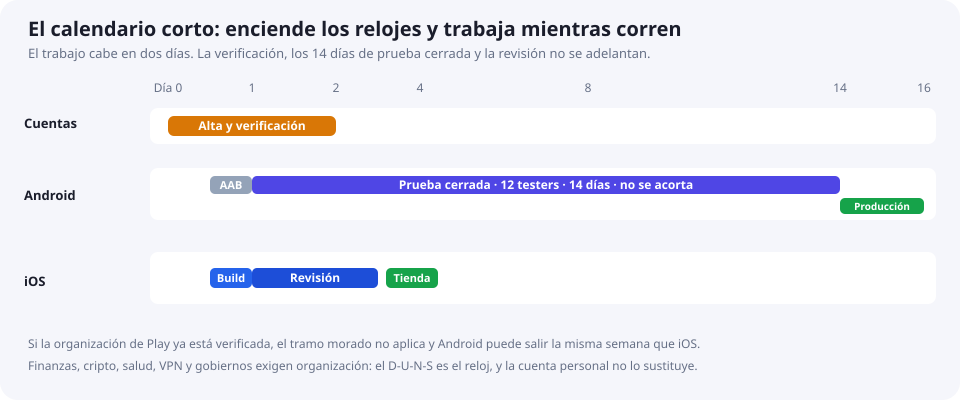

# 00 · El calendario corto

Publicar rápido es meter el trabajo dentro de las esperas, no hacer más pasos por hora. Esta es la secuencia que no añade días de más.

## Día a día

| Cuándo | Qué haces | Por qué ese día |
|---|---|---|
| Día 0, primera hora | Altas en Play Console y Apple Developer | La verificación es el primer reloj. Márcala hecha al enviar el formulario |
| Día 0 | ID `com.tuempresa.app`, política en una URL, lista de 12 testers, cuenta demo | Nada de esto necesita un build |
| Día 1 | AAB de release → prueba interna en un teléfono → prueba cerrada | Enciende los 14 días. La primera subida a Play es manual |
| Día 1-2 | En paralelo: Archive de iOS, TestFlight, metadatos | iOS no espera a Android. TestFlight no pide 14 días |
| Día 2-3 | Enviar iOS a revisión, después de [la compuerta](06-antes-de-enviar.md) | La revisión (24-48 h, a veces más) corre durante los 14 días |
| Día 4-6 | iOS puede estar en la tienda | Lanzamiento por fases si quieres poder pausar |
| Día 14+ | Pedir producción en Play y abrir al 10-20 % | La fecha que vale es la de tu consola, no un cálculo de este repo |

Si la cuenta de Play es de **organización y ya está verificada**, el tramo de 14 días no existe: Android puede salir la misma semana que iOS. Ese atajo de la cuenta personal no existe cuando Play exige organización: banca, préstamos, trading, fondos, exchange, billetera de software de criptomonedas, ciertas apps de salud, VPN y gobiernos. Ahí el reloj es el D-U-N-S. Pedirlo en Dun & Bradstreet es gratis y, si la empresa no lo tiene, puede tardar hasta 30 días. En la App Store, una billetera de cripto la ofrece un desarrollador organización, y un exchange necesita licencia en cada país de la ficha. Detalle en [02 · Android](02-android.md#apps-financieras-y-de-criptomonedas) y [03 · iOS](03-ios.md#criptomonedas-y-servicios-financieros).

## Tiempos de las tiendas, no del teclado

| Espera | Android | iOS |
|---|---|---|
| Cuenta | Minutos a unos días (identidad; más si es organización) | A menudo 1-2 días; más si es organización |
| Primer binario firmado | 30-90 min si el proyecto ya compila | 1-2 h, o el tiempo de una cola de EAS / CI |
| Prueba obligatoria | Cuenta personal creada después del 13 nov 2023: 12 testers × 14 días. La interna no cuenta. Organización: no aplica ese requisito | TestFlight interno: sin revisión de testers |
| Revisión de la tienda | Horas a pocos días | Normalmente 24-48 h |
| Calendario mínimo | ~2,5 semanas (personal nueva) o unos días (organización ya verificada) | ~3-6 días |

El trabajo activo, si no te paras a rediseñar capturas ni a pelear la firma, cabe en el día 0 y el día 1.

## Qué necesitas para no bloquearte

- **Android:** cualquier sistema, JDK 17+, Android SDK, un teléfono Android real. El emulador sirve para las capturas; el crash del release se ve en el teléfono.
- **iOS:** un Mac con Xcode, o un build en la nube (EAS si es Expo, Codemagic, GitHub Actions con runner macOS). Un iPhone para el TestFlight final.
- **Expo** es el camino con menos firma manual. Plantilla: [`templates/eas.json`](../templates/eas.json).

Sigue en [01 · Preparación](01-preparacion.md).
