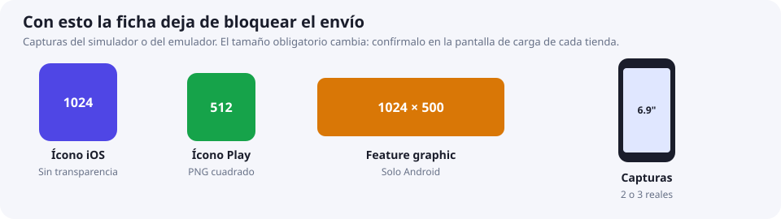

# 01 · Preparación (común a Android e iOS)

## 1. Identificador y versión

- **ID único**: `com.tuempresa.nombreapp`. Es el `applicationId` en Android y el Bundle ID en iOS. Después de subir el primer AAB a esa ficha de Play, el identificador de paquete no se cambia.
- **Versionado**: usa `MAJOR.MINOR.PATCH` para el usuario (`1.0.0`) y un contador entero creciente para la tienda (`versionCode` / build number).

| Concepto | Android | iOS |
|---|---|---|
| Versión visible | `versionName` | `CFBundleShortVersionString` (Version) |
| Contador interno | `versionCode` | `CFBundleVersion` (Build) |

## 2. Cuentas de desarrollador

| | Google Play Console | Apple Developer Program |
|---|---|---|
| Costo | USD 25 pago único | USD 99 / año |
| Tipos | Personal u Organización | Individual u Organización |
| Verificación | Identidad (y D-U-N-S para organizaciones) | Identidad (y D-U-N-S para organizaciones) |
| Enlace | https://play.google.com/console | https://developer.apple.com/programs |

> [!tip] Individual vs Organización
> El D-U-N-S se pide gratis en Dun & Bradstreet. Una organización ya verificada no tiene el requisito de 12 testers durante 14 días de las cuentas personales nuevas, y en las dos tiendas el publicador es la empresa. Play **exige** organización si la app es de banca, préstamos, trading, fondos, exchange, billetera de software de criptomonedas, de ciertas categorías de salud, usa `VpnService` o es de un gobierno. En esos casos una cuenta personal no acorta nada. Todas las apps, también las que no son financieras, completan la declaración de funciones financieras en Play. En la App Store, una billetera de criptoactivos la ofrece un desarrollador inscrito como organización, y un exchange necesita licencia en cada país de la ficha.

## 3. Assets de tienda

Llena [`templates/store-listing.md`](../templates/store-listing.md) una sola vez. Con el paquete mínimo la ficha deja de bloquear el envío; el resto se puede cambiar con la prueba ya publicada.

Saca las capturas del simulador (iOS: *Archivo → Guardar pantalla*) o del emulador de Android. No esperes un set ilustrado: si no coincide con la app, lo rechazan.

| Asset | Android (Play) | iOS (App Store) |
|---|---|---|
| Ícono | 512×512 PNG | 1024×1024 PNG, sin transparencia ni esquinas redondeadas |
| Capturas | Mínimo 2 de teléfono (lados entre 320 y 3840 px) | iPhone 6.9" (p. ej. 1320×2868) obligatorio; iPad si soportas iPad |
| Gráfico extra | Feature graphic 1024×500 | — |
| Nombre | Hasta 30 caracteres | Hasta 30 caracteres |
| Descripción corta / subtítulo | Hasta 80 caracteres | Subtítulo hasta 30 caracteres |
| Descripción larga | Hasta 4000 caracteres | Hasta 4000 caracteres |
| Política de privacidad | URL pública (obligatoria) | URL pública (obligatoria) |
| Soporte | Email | URL de soporte |

> [!warning] Verifica tamaños vigentes
> Apple y Google actualizan los tamaños requeridos con cada generación de dispositivos. Confírmalos en la pantalla de carga de cada consola.

## 4. Configuración de producción

- [ ] Variables apuntan a **API de producción** (no staging, no localhost).
- [ ] Sin `console.log` sensibles ni menús de debug visibles.
- [ ] Sin claves/secretos en el repo (usa `.env` fuera de Git o secretos de CI).
- [ ] Permisos mínimos: solo los que realmente usas, con texto claro de por qué (`NSCameraUsageDescription`, etc.).
- [ ] Si la app **crea cuentas**: botón para **eliminar cuenta** dentro de la app (Apple) y una URL pública que lo explique (Play). Borrador: [`templates/account-deletion.md`](../templates/account-deletion.md).
- [ ] Si ofreces login con Google/Facebook en iOS: ofrece también **Sign in with Apple** (salvo excepciones).
- [ ] Si vendes contenido digital: usa compras in-app de la tienda, no pagos externos.
- [ ] Cuenta demo con datos para el revisor si hay login.
- [ ] Probado en dispositivo real con el build **release**, no solo debug.
