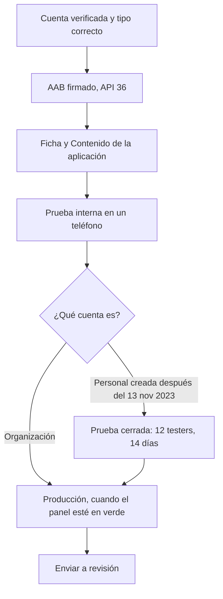

# 02 · Android → Google Play

Subir un `.aab` y conseguir que Google lo apruebe en producción son dos cosas distintas. La ficha, el bundle y las declaraciones se pueden dejar listos en uno o dos días. La revisión no tiene plazo garantizado. Y, según la cuenta, hay una espera previa que no se acorta: 14 días de prueba cerrada, o el alta de una organización.



## Qué cuenta te toca

| Cuenta | Cuándo usarla | Antes de producción |
|---|---|---|
| Personal creada después del 13 de noviembre de 2023 | Una app tuya, que no sea de una empresa ni de las categorías de abajo | Prueba **cerrada** con al menos 12 testers inscritos de forma continua durante 14 días, y luego solicitar acceso a producción |
| Organización ya verificada | La app es de una empresa, o Play exige este tipo de cuenta | No aplica ese requisito de 12 testers y 14 días. Siguen la ficha, las declaraciones y la revisión |
| Organización todavía sin verificar | La titular es una empresa, o la categoría lo exige | El D-U-N-S es gratis en Dun & Bradstreet y puede tardar hasta 30 días si la empresa aún no tiene número. Ese es el cuello de botella |

Play exige cuenta de **organización** si la app ofrece servicios financieros (banca, préstamos, trading, fondos, exchange o billetera de software de criptomonedas), si es de salud de las categorías médicas, si usa `VpnService`, o si es de un gobierno. No abras una cuenta personal para saltarte los 14 días: en esos casos la cuenta personal no cumple la política. Detalle en [Apps financieras y de criptomonedas](#apps-financieras-y-de-criptomonedas).

Fuentes: [tipo de cuenta](https://support.google.com/googleplay/android-developer/answer/13634885?hl=es-419), [pruebas para cuentas personales nuevas](https://support.google.com/googleplay/android-developer/answer/14151465?hl=es-419).

<a id="cuenta"></a>

## Paso 1 · Verificar la cuenta

1. Entra en [Google Play Console](https://play.google.com/console) con la cuenta Google que va a administrar la app.
2. Elige Personal u Organización según el titular real. Si la app es de una empresa, la cuenta es de esa empresa.
3. Completa la verificación de identidad, el contacto y lo que pida el panel.
4. Paga el registro: USD 25, una sola vez.
5. Si es organización, el número D-U-N-S tiene que coincidir con el perfil de Dun & Bradstreet. Pedirlo por Dun & Bradstreet es gratis; desconfía de quien cobre por tramitarlo.

Márcalo hecho cuando envíes el alta, no cuando terminen de verificarte. Mientras tanto genera el AAB y la ficha.

<a id="aab"></a>

## Paso 2 · Generar el AAB firmado

El `applicationId` queda fijo en cuanto subes el primer artefacto a esa ficha. El `versionCode` es un entero mayor que el de cualquier subida anterior. El `versionName` es el que ve la gente, por ejemplo `1.0.0`.

Desde el 31 de agosto de 2026, una app nueva o una actualización para teléfono tiene que apuntar a **Android 16 (API 36)** o superior. Hay un formulario de prórroga en la consola hasta el 1 de noviembre de 2026. Wear OS y Android Automotive piden API 35; Android TV y Android XR, API 34. Si tu caso es otro, manda el aviso de la consola: [requisito de API](https://support.google.com/googleplay/android-developer/answer/11926878?hl=es-419).

En `android/app/build.gradle` (o `.kts`):

```gradle
android {
  defaultConfig {
    applicationId "com.tuempresa.app"
    versionCode 1
    versionName "1.0.0"
    targetSdkVersion 36
  }
}
```

**React Native**, desde la raíz del proyecto:

```bash
cd android && ./gradlew bundleRelease
```

El archivo queda en `android/app/build/outputs/bundle/release/app-release.aab`. Si el proyecto tiene variantes o una firma con otro nombre, la ruta cambia.

| Tecnología | Comando | Salida |
|---|---|---|
| React Native | `cd android && ./gradlew bundleRelease` | `android/app/build/outputs/bundle/release/app-release.aab` |
| Flutter | `flutter build appbundle --release` | `build/app/outputs/bundle/release/app-release.aab` |
| Expo | `npx eas-cli build -p android --profile production` | descarga desde EAS |
| Nativo | `./gradlew bundleRelease` | `app/build/outputs/bundle/release/app-release.aab` |

Play App Signing guarda la clave de firma de la app. Tú subes el `.aab` firmado con la clave de carga (upload key).

```bash
keytool -genkeypair -v -storetype PKCS12 -keystore upload-keystore.jks \
  -alias upload -keyalg RSA -keysize 2048 -validity 10000
```

> [!danger] Respalda el keystore
> Guarda el `.jks` y las contraseñas fuera de Git. Perder la upload key no impide publicar para siempre, pero el reseteo para el calendario.

**React Native / nativo** — `android/gradle.properties` local, fuera de Git:

```properties
MYAPP_UPLOAD_STORE_FILE=upload-keystore.jks
MYAPP_UPLOAD_KEY_ALIAS=upload
MYAPP_UPLOAD_STORE_PASSWORD=***
MYAPP_UPLOAD_KEY_PASSWORD=***
```

y en `android/app/build.gradle`:

```gradle
android {
  signingConfigs {
    release {
      storeFile file(MYAPP_UPLOAD_STORE_FILE)
      storePassword MYAPP_UPLOAD_STORE_PASSWORD
      keyAlias MYAPP_UPLOAD_KEY_ALIAS
      keyPassword MYAPP_UPLOAD_KEY_PASSWORD
    }
  }
  buildTypes { release { signingConfig signingConfigs.release } }
}
```

**Flutter** usa `android/key.properties` (fuera de Git) y lo lee en `android/app/build.gradle(.kts)`. **Expo** lo resuelve con `npx eas-cli credentials --platform android`.

Instala ese release en un teléfono real antes de subirlo. El emulador sirve para las capturas; el crash de producción se ve en el dispositivo.

<a id="crear-app"></a>

## Paso 3 · Crear la aplicación

1. En Play Console, **Crear aplicación**.
2. Nombre público, idioma predeterminado, app o juego, gratis o de pago. De gratis a de pago no se vuelve atrás.
3. Datos de contacto y las declaraciones que pida el alta.
4. Abre el panel. El nombre, el `applicationId` y la titularidad tienen que ser los definitivos.

<a id="contenido"></a>

## Paso 4 · Contenido de la aplicación

En **Política y programas → Contenido de la aplicación** (en la consola en inglés: *Policy and programs → App content*). El panel de tareas pendientes tiene que quedar sin bloqueos. Las obligaciones exactas dependen de lo que declare la app; estas son las que casi siempre paran el envío:

| Requisito | Qué preparar |
|---|---|
| Política de privacidad | URL pública, sin login, con el nombre de la app |
| Seguridad de los datos | Lo que recogen la app y sus SDK, si se comparte y para qué |
| Funciones financieras | Todas las apps la completan. Si no hay ninguna, se certifica así. Si hay cripto, banca o pagos, se declara la función real |
| Clasificación de contenido | El cuestionario de edades |
| Público objetivo | Edades a las que va dirigida. Incluir menores activa reglas de Familias |
| Anuncios | Si la app lleva publicidad o no |
| Acceso para la revisión | Usuario, clave e instrucciones si hay login, OTP o un permiso especial |
| Eliminación de cuenta | Si se crean cuentas: dentro de la app y una URL web. Borrador en [`templates/account-deletion.md`](../templates/account-deletion.md) |
| Permisos sensibles | La declaración extra que pida Play, o quitar el permiso |

No hace falta un vídeo promocional para una ficha normal.

<a id="ficha"></a>

## Paso 5 · Ficha de Play Store

Con esto la ficha deja de bloquear el envío. El resto se edita con la prueba ya publicada.

- Nombre, descripción breve (80) y descripción completa (4000).
- Ícono 512×512.
- Al menos dos capturas de teléfono, del tamaño que marque la pantalla de carga.
- Correo de contacto. Sitio web si lo tienes.
- La política de privacidad y la clasificación del paso anterior.

Textos en [`templates/store-listing.md`](../templates/store-listing.md).

<a id="apps-financieras-y-de-criptomonedas"></a>

## Apps financieras y de criptomonedas

Si la app ofrece exchange o una billetera de software de criptomonedas, la cuenta de desarrollador tiene que ser de **organización**. Lo mismo vale para banca, préstamos, trading de valores y fondos. No es un atajo opcional.

1. Confirma qué entidad legal es la titular y si ya tiene Play Console de organización y D-U-N-S. Trabajar sobre una cuenta ya verificada evita el alta.
2. En Contenido de la aplicación, declara en **Funciones financieras** lo que la app hace de verdad: exchange, billetera de criptomonedas, pagos, u otra. Aunque no haya ninguna función financiera, el formulario se envía marcando que no las hay.
3. Revisa la [política de exchanges y billeteras de criptomonedas](https://support.google.com/googleplay/android-developer/answer/16329703?hl=es-419). Las billeteras no custodiales quedan fuera de esa política concreta; la declaración de funciones financieras se completa igual.
4. En los países donde Play pide licencia o registro, o los tienes o los quitas de la distribución. No des por publicada la app por haber rellenado el formulario: también tiene que cumplir la norma del servicio y del país.

El D-U-N-S, si la empresa no lo tiene, es el reloj largo de este camino. Los 14 días de una cuenta personal no lo sustituyen.

<a id="pruebas"></a>

## Paso 6 · Probar y publicar

La **primera** subida de una app nueva se hace a mano en la consola. La API y `eas submit` fallan si lo intentas antes.

1. **Prueba interna** — *Prueba y lanzamiento → Pruebas → Prueba interna*. Crea la versión, sube el `.aab`, escribe las notas, publica e invita testers (hasta 100). Llega en minutos. Instala en teléfonos reales: inicio, operaciones, red y los flujos que no pueden fallar. Esto no es la tienda pública y **no cumple** los 14 días de las cuentas personales nuevas.
2. **Prueba cerrada** — solo si la cuenta personal es de las de la tabla de arriba. *Prueba y lanzamiento → Pruebas → Prueba cerrada*. 12 testers inscritos de forma continua durante 14 días. Puedes subir otro `.aab` a la misma prueba mientras el reloj corre. Mensaje listo: [`templates/mensaje-testers.md`](../templates/mensaje-testers.md). En una organización, márcalo como no aplica y confírmalo en el panel.
3. **Acceso a producción** — en las cuentas personales nuevas, el botón aparece cuando Play da por cumplidos esos 14 días. La fecha que vale es la de la consola.
4. **Producción** — *Prueba y lanzamiento → Producción*. Crea la versión con el `.aab` ya probado, elige países, revisa los errores que bloquean el envío y pulsa **Enviar para revisión**. Un despliegue al 10-20 % deja margen para pausar si hay crashes.

No hay un plazo garantizado de aprobación. No convoques el lanzamiento dando por hecho que la primera revisión sale.

## Después

Mira Android vitals las primeras 48 h. Si algo se rompe: detén el despliegue y sube un parche con `versionCode` mayor.

La compuerta de antes de enviar está en [06 · Antes de enviar](06-antes-de-enviar.md).
