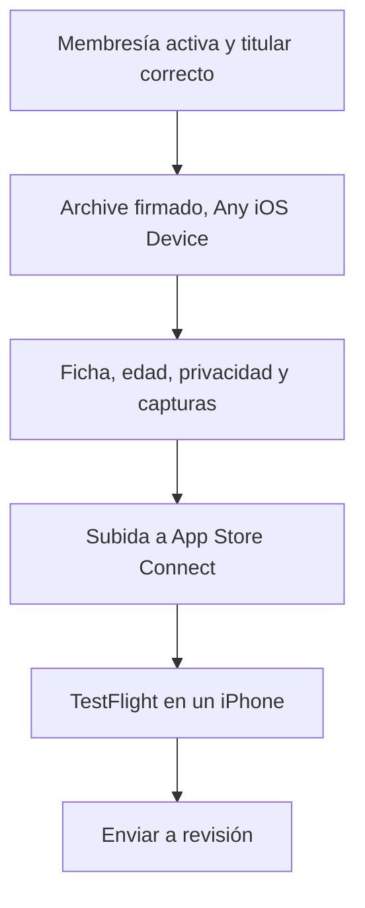

# 03 · iOS → App Store

Subir un build y conseguir que Apple lo apruebe son dos cosas distintas. El Archive, la ficha y las declaraciones se pueden dejar listos en uno o dos días, en paralelo. La revisión no tiene un plazo garantizado. Si la app es de una empresa, o si ofrece una billetera, un exchange o un servicio financiero, la cuenta de organización y las autorizaciones son el tramo que no se acorta con un Archive más rápido.

El plazo de 14 días es de ciertas cuentas nuevas de Google Play. En la App Store, TestFlight es una prueba del binario de tienda y se puede hacer el mismo día del Archive.

## Paso 1 · Cuenta Apple Developer

Portales:

- [Inscripción al Apple Developer Program](https://developer.apple.com/programs/enroll/)
- [Comparación de membresías](https://developer.apple.com/support/compare-memberships/)
- [App Store Connect](https://appstoreconnect.apple.com/)

1. Membresía activa. El programa estándar cuesta USD 99 al año, según la región y los impuestos.
2. Identidad y contacto verificados. El Apple ID del titular tiene la verificación en dos pasos.
3. Acuerdos vigentes aceptados en App Store Connect. Sin eso, la ficha no deja enviar.
4. Permiso para crear apps y subir versiones.

Si la app es de una empresa, la membresía es de esa organización. Apple verifica la entidad y pide el D-U-N-S. Cuando el contrato de distribución tiene que estar a nombre de la empresa, la cuenta es esa organización. Pedir el D-U-N-S en Dun & Bradstreet es gratis; el buscador de Apple está en [developer.apple.com/enroll/duns-lookup](https://developer.apple.com/enroll/duns-lookup/).

Una billetera de criptoactivos, además, tiene que ofrecerla un desarrollador inscrito como organización. El detalle está en [Criptomonedas y servicios financieros](#criptomonedas-y-servicios-financieros).

Márcalo hecho cuando envíes el alta, no cuando Apple termine de revisar la inscripción. Mientras tanto puedes registrar el Bundle ID y preparar la ficha.

## Paso 2 · Compilar y subir

En un Mac, con React Native CLI:

1. Abre el `.xcworkspace` de `ios/`, no el `.xcodeproj`.
2. Elige el target de la app.
3. En **Signing & Capabilities**, comprueba el equipo, la firma automática y el Bundle Identifier. Tiene que ser el mismo que registrarás en la ficha.
4. El destino es **Any iOS Device (arm64)**. El Archive de tienda sale de ese destino.
5. **Product → Archive**.
6. **Window → Organizer** → el archive → **Distribute App → App Store Connect → Upload**.
7. Espera a que Apple procese el build. Hasta entonces no se puede elegir en la versión.

Xcode envía la compilación directo a App Store Connect. Guía de Apple: [subir compilaciones](https://developer.apple.com/help/app-store-connect/manage-builds/upload-builds/).

| Tecnología | Generar | Subir |
|---|---|---|
| React Native | `cd ios && pod install`, luego Xcode → Product → Archive. Equipos: `bundle exec fastlane gym` | Organizer → Distribute App. O Transporter, o `fastlane pilot upload` |
| Flutter | `flutter build ipa --release` | Transporter o `fastlane pilot upload --ipa build/ios/ipa/*.ipa` |
| Expo | `npx eas-cli build -p ios --profile production` | `npx eas-cli submit -p ios --latest` |
| Nativo | Xcode → Product → Archive | Organizer → Distribute App |

| Escenario | Firma |
|---|---|
| Una persona y un Mac | Xcode → Signing & Capabilities → Automatically manage signing → tu Team |
| Equipo o CI | `fastlane match` con los certificados cifrados en un repo privado |
| Expo | `npx eas-cli credentials --platform ios` |
| Sin Mac | EAS, Codemagic o GitHub Actions con runner macOS. El Archive no sale de un simulador ni de Linux |

> [!tip] Clave de API
> En App Store Connect: Users and Access → Integrations → App Store Connect API. Guarda el `.p8` fuera de Git. Sirve para subir desde CI sin la contraseña de la cuenta.

Antes de dar el build por bueno, en un iPhone real:

- La app abre y no se cierra sola.
- No hay botones muertos ni pantallas a medias.
- Cada permiso (cámara, notificaciones, fotos) tiene un uso real y un texto que lo dice.
- El backend de producción responde por HTTPS. Nada de `localhost`.
- El inicio de sesión y las funciones principales ocurren en ese build, no en uno de debug.

El número de **Build** sube en cada envío. La **Version** (`1.0.0`) es la que ve la gente. En Xcode están en Target → General.

## Paso 3 · Ficha de App Store Connect

1. [App Store Connect](https://appstoreconnect.apple.com/) → **Apps → + → New App**.
2. Plataforma iOS y el nombre público.
3. El Bundle ID ya registrado. Después no se cambia en esa ficha.
4. Un SKU interno, único, que la gente no ve.
5. Idioma principal.
6. Metadatos, capturas, categoría, clasificación por edad y privacidad.
7. Cuando el build termine de procesarse, selecciónalo en la versión.

Hace falta al menos una captura de cada tamaño de iPhone que la ficha marque como obligatorio. Si la app admite iPad, también las de iPad. El vídeo de vista previa es opcional.

Registra el Bundle ID antes, en [Certificates, IDs & Profiles](https://developer.apple.com/account/resources/identifiers/list) → Identifiers → App IDs. Activa solo las capacidades que la app usa: Push, Sign in with Apple u otras.

## Paso 4 · Lo que Apple pide siempre

| Elemento | Qué preparar |
|---|---|
| Política de privacidad | URL pública que describa lo que la app hace de verdad |
| Privacidad de la app | Datos que recogen la app y los SDK, no solo el código propio |
| Clasificación por edad | El cuestionario. No se elige una edad a mano |
| Información de revisión | Qué hace la app y cómo probarla |
| Cuenta de demostración | Usuario y clave si hay login. Sin 2FA, o con el código escrito en las notas |
| Información comercial | Nombre, descripción, categoría, URL de soporte y contacto |
| Derechos de contenido | Permiso de marcas, imágenes, música o contenido de terceros, si los hay |
| Documentación financiera | Solo si el servicio está regulado: licencias, autorizaciones o el contrato con el proveedor |

Una ficha incompleta se rechaza y vuelve a la cola. Los textos oficiales: [directrices de revisión](https://developer.apple.com/app-store/review/guidelines/), [en español](https://developer.apple.com/app-store/review/guidelines/es/), [privacidad de las apps](https://developer.apple.com/help/app-store-connect/reference/app-privacy/) y [qué hace falta para una revisión completa](https://developer.apple.com/help/app-review/before-submitting-for-review/complete-review/).

## Categoría

Elige la categoría que describe la función principal, no la que suene mejor en la tienda. En App Store Connect hay una principal y, si hace falta, una secundaria.

| Categoría | Cuándo encaja |
|---|---|
| Finanzas | Billetera, gestión de dinero, operaciones financieras, criptoactivos |
| Productividad | Tareas, calendario, herramientas de trabajo |
| Educación | La función principal es enseñar |
| Compras | Descubrir y comprar productos o servicios comerciales |

La categoría no sustituye una licencia. Una app de cripto en Finanzas sigue teniendo que cumplir la norma del servicio y del país.

## Clasificación por edad

Apple calcula la edad con un cuestionario de contenido, funciones y riesgos. Las respuestas salen de lo que la app hace.

| Resultado | Qué suele representar |
|---|---|
| 4+ | Contenido para público general, incluidos niños pequeños |
| 9+ | Algún elemento moderado, según las respuestas |
| 13+ | Temas o funciones de más madurez |
| 16+ | Más madurez, según el criterio vigente |
| 18+ | El tramo más restringido del cuestionario |

El resultado puede ser 4+, 9+, 13+, 16+ o 18+. Una app financiera puede caer en cualquiera de esos tramos, según el cuestionario. Responde con las funciones reales: compra y venta de activos, contenido financiero, chat u otras. Ofrecer esas operaciones a menores exige la autorización legal, aparte de la edad que salga. Manual: [configurar la clasificación por edad](https://developer.apple.com/help/app-store-connect/manage-app-information/set-an-app-age-rating/).

## Criptomonedas y servicios financieros

Si la app no guarda cripto, no opera un exchange y no presta un servicio financiero regulado, marca este tramo como no aplica y sigue con el Archive.

| Función | Qué mira Apple |
|---|---|
| Billetera de criptoactivos | La ofrece un desarrollador inscrito como **organización** |
| Compra y venta de criptomonedas | Opera en un exchange aprobado y tiene las licencias de los países donde se distribuye |
| Proveedor o exchange externo | Hay que poder acreditar la relación comercial si Apple la pide |
| Servicio de una entidad financiera | Apple puede pedir el documento que une la app con esa entidad |
| Datos sensibles y KYC | La declaración de privacidad coincide con el flujo, y el revisor puede entrar a probarlo |

Ten a mano, por si la revisión los pide:

- La entidad legal que presta el servicio.
- Licencias o autorizaciones por territorio. Donde no las haya, ese país no entra en la distribución.
- El contrato con el banco, el exchange o el proveedor, si la app no es ese proveedor.
- Una cuenta de demostración y los pasos de compra, venta, depósito y retiro.
- Qué datos pide el KYC y para qué.

Apple pide esos papeles según las funciones de la app. En un exchange contempla licencias por territorio y acuerdos con terceros. Una entrega a medias se rechaza y hay que volver a enviar. La norma está en las [directrices de revisión](https://developer.apple.com/app-store/review/guidelines/es/).

## Paso 5 · TestFlight

Sirve para ver el binario de tienda en un iPhone antes de la revisión pública. Se puede hacer el mismo día: el plazo de 14 días es de ciertas cuentas de Play.

1. App Store Connect → tu app → **TestFlight**.
2. Espera a que el procesamiento termine.
3. Responde el cumplimiento de exportación. Si solo usas HTTPS, se declara en el formulario.
4. Invítalo a testers internos (gente de tu equipo en App Store Connect; no pasan una revisión aparte).
5. Recorre inicio de sesión y las funciones que no pueden fallar.

Los testers externos sí pasan una revisión beta corta. Para cazar un crash antes del envío, bastan los internos.

## Paso 6 · Enviar a revisión

1. Abre la versión de iOS.
2. Asígnale el build ya procesado.
3. Cierra metadatos, privacidad y edad. El panel no puede tener errores que bloqueen el envío.
4. En **App Review Information**, la cuenta demo y las instrucciones. Si hay papeles financieros, van aquí o donde la consola los pida.
5. **Add for Review** y después **Submit for Review**.
6. Si Apple escribe, responde en Resolution Center con el cambio o el documento, no con un argumento.
7. Cuando aprueben, publica sola o a mano, según lo que hayas elegido. El lanzamiento por fases (7 días) se puede pausar si aparecen crashes.

Manual: [enviar una app a revisión](https://developer.apple.com/help/app-store-connect/manage-submissions-to-app-review/submit-an-app).

Espera el resultado de la revisión antes de convocar el lanzamiento. Si falta una licencia o la cuenta demo no entra, el rechazo devuelve la app al final de la cola.

## Qué hacer cada día

El día 1 confirma la cuenta —de organización, si la titular es una empresa o si la app es una billetera o un exchange—, genera el Archive y súbelo mientras armas la ficha. El día 2 cierra TestFlight, las credenciales y los documentos que falten. Después envía, cuando no quede un error que bloquee el botón.

Eso es un plan de trabajo. No es una aprobación en 48 horas. El Archive se controla en el Mac. La inscripción de la organización, las licencias y la revisión de Apple marcan el calendario.

La lista de antes de enviar está en [06 · Antes de enviar](06-antes-de-enviar.md).
