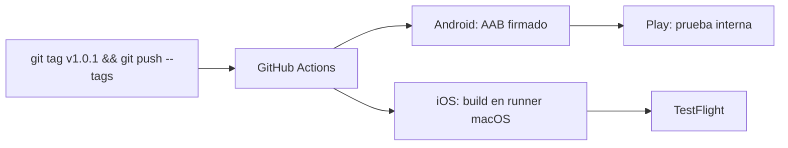

# 04 · CI/CD: publicar con un tag

> [!important] Primero publica la primera versión a mano
> Ambas tiendas requieren que la primera versión (y su ficha) exista. Automatiza desde la segunda.

## Opciones

| Opción | Cuándo usarla |
|---|---|
| **EAS Build + Submit** (Expo) | Proyecto Expo; cero configuración de firma. Copia [`templates/eas.json`](../templates/eas.json): `autoIncrement` evita repetir `versionCode` / build number. Revisa el formato vigente de `eas.json` si el CLI lo rechaza |
| **GitHub Actions + fastlane** | React Native / Flutter / nativo, control total |
| **Codemagic** | Flutter/RN sin querer mantener runners macOS |

## Secretos en GitHub (Settings → Secrets and variables → Actions)

**Android**
| Secreto | Valor |
|---|---|
| `ANDROID_KEYSTORE_BASE64` | `base64 -w0 upload-keystore.jks` (macOS: `base64 -i upload-keystore.jks`) |
| `ANDROID_KEY_ALIAS` / `ANDROID_STORE_PASSWORD` / `ANDROID_KEY_PASSWORD` | datos del keystore |
| `PLAY_SERVICE_ACCOUNT_JSON` | JSON de la cuenta de servicio (Play Console → Configuración → Acceso a la API) |

**iOS**
| Secreto | Valor |
|---|---|
| `ASC_KEY_ID`, `ASC_ISSUER_ID` | de la API key de App Store Connect |
| `ASC_KEY_CONTENT` | contenido del `.p8` en base64 |
| `MATCH_PASSWORD`, `MATCH_GIT_URL`, `MATCH_GIT_BASIC_AUTHORIZATION` | para `fastlane match` |

## Plantillas listas
- [`templates/ci/android-release.yml`](../templates/ci/android-release.yml) → copia a `.github/workflows/`
- [`templates/ci/ios-release.yml`](../templates/ci/ios-release.yml) → copia a `.github/workflows/`
- [`templates/fastlane/Fastfile`](../templates/fastlane/Fastfile) → copia a `ios/fastlane/Fastfile`

Ajusta nombres (`App`, rutas, `packageName`) a tu proyecto. Las acciones están fijadas a versiones mayores; revísalas periódicamente.
